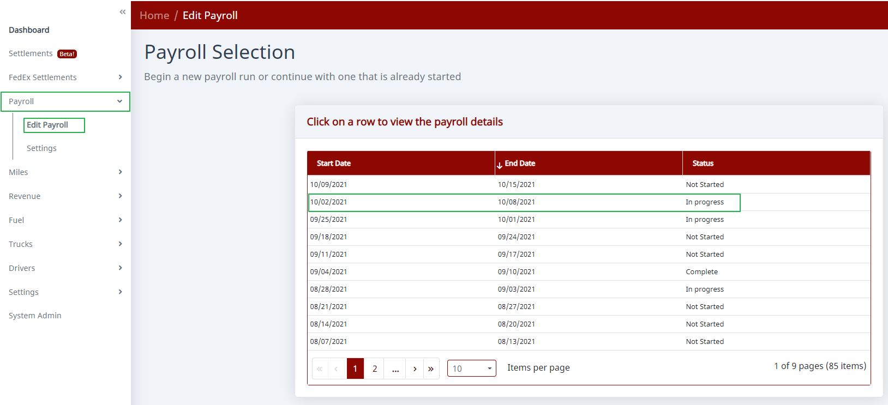
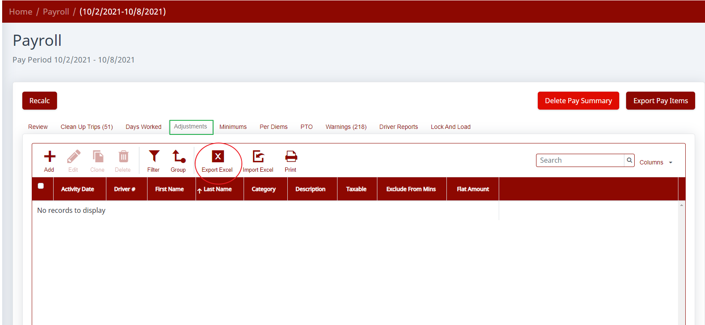

Batch payroll adjustments save time by letting you create all your adjustments in Excel and upload them to Haldi FCS at once. For example, instead of entering a quarterly bonus for each driver individually, you can add them all with one upload.

## Step 1. Open the payroll

Go to **Payroll** on the left menu, then double-click the payroll you want to work on.

## Step 2. Export the Excel template

Open the **Adjustments** tab and click **Export Excel**.

In the popup, choose **Pre-Filled Import Template** and click **Export**. This gives you an Excel file with all the drivers already listed.

## Step 3. Edit the file

Fill in the **Category**, **Description**, **Taxable**, **Exclude From Minimum**, and **Amount** columns as needed. You can add or delete rows, make multiple adjustments for one driver, and so on.

## Step 4. Import it back

Save the file and import it back into Haldi FCS to create all the adjustments at once.
