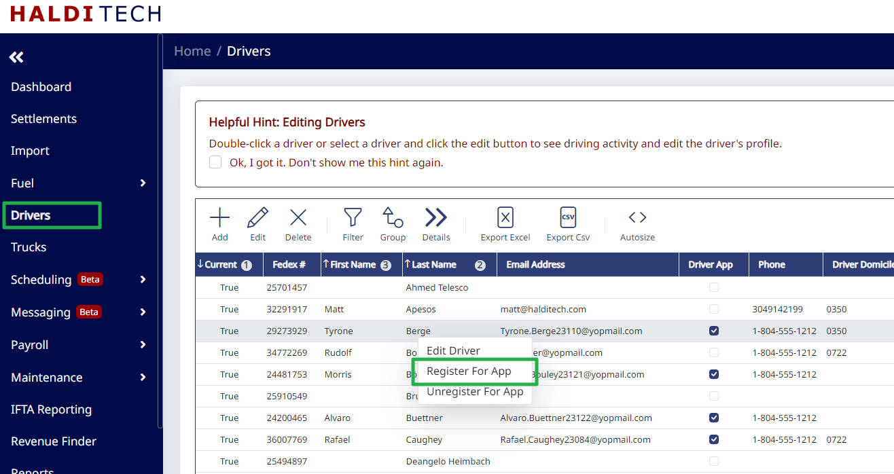

# Driver App - Getting Started

## Step 1. Enable the driver app

Contact HaldiTech support ([support@halditech.com](mailto:support@halditech.com)) and have them enable the driver app on your account.

## Step 2. Check driver contact info

Go to **Drivers** in the left menu. Make sure each driver has an **email address** and **phone number** on their record — those are needed to register them for the app.

## Step 3. Register each driver for the app

**Right-click** a driver and choose **Register For App**. The driver receives an email with instructions to set up their account. (To revoke access later, right-click and choose **Unregister For App**.)

Once registered, drivers can log in to the mobile app to see their dispatch, request time off, and message dispatch.
