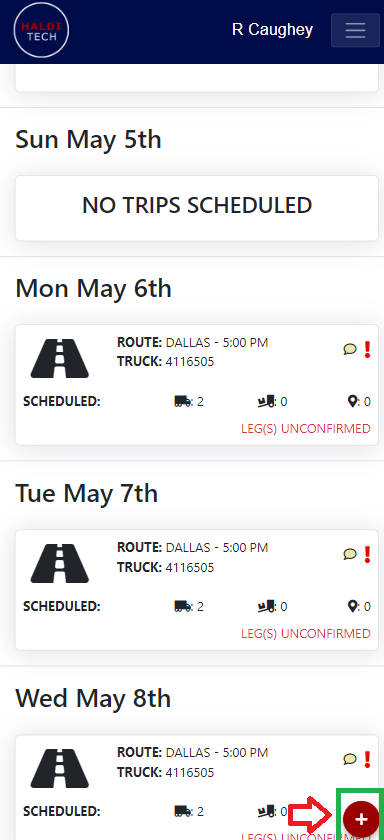

# Requesting Time Off

In the mobile app, on the **Dispatch** screen, tap the red **+ (Actions)** button in the bottom-right corner and choose **Time-Off Request**.

Set the **Starting** and **Ending** date/time, add a **Description**, then save your request. It will show a status of **REQUESTED** until your dispatcher reviews it.

