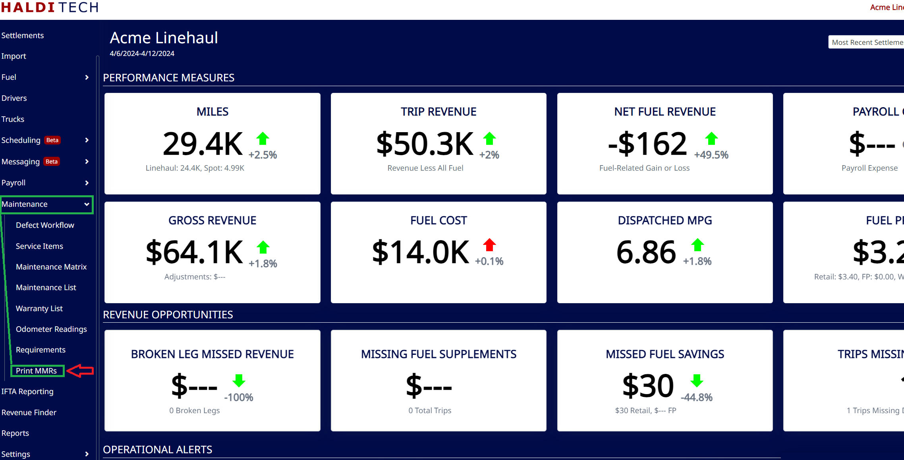

## Accessing MMRs

Go to **Maintenance > MMR Reporting**. It's a four-step wizard.

### Step 1. Select the date range

Choose a **Date Range**, or use the **Quick Pick** dropdown (Last Month, last quarter, last year, etc.), then click **Run Analysis**.

### Step 2. Select the trucks to include

Once the analysis runs, check the trucks you want to include in the MMR.

### Step 3. Add your signature

Add your signature and save it.

### Step 4. Download

Download the MMRs **with or without attachments**. The PDF downloads for you to review and submit.
