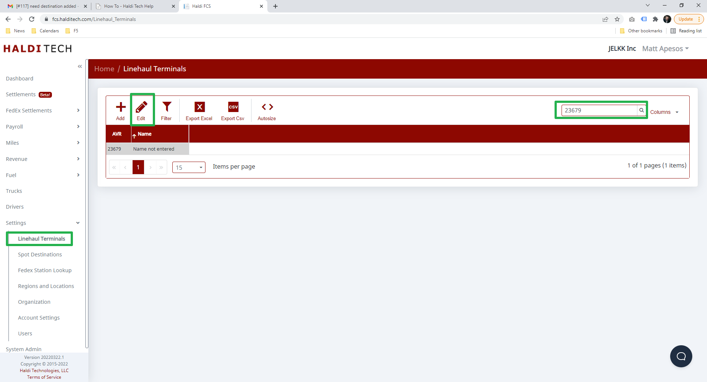

Go to **Settings > Linehaul Terminals**. Use the **Search** box (top right) to find the station number (**AVR**) you're looking for.

Double-click the terminal's row to make it editable **directly in the grid**, type the terminal name in the **Name** column, and save your change. The name updates automatically throughout the system.
