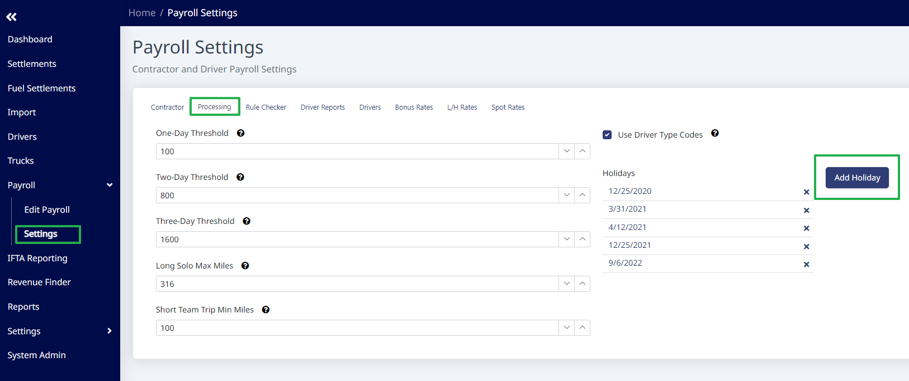
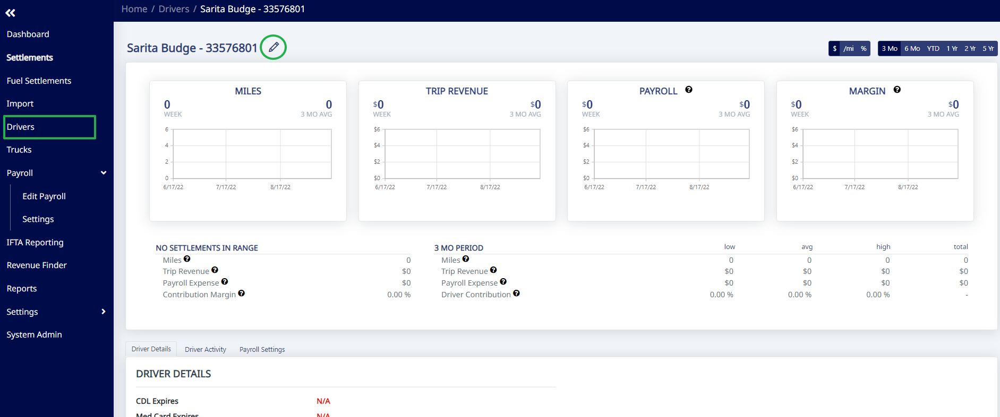

Paying holiday bonuses has two parts: turn the feature on and add your holiday dates, then set a bonus for each eligible driver.

## Turn on holiday bonuses and add holiday dates

Go to **Payroll > Settings**. On the **Contractor** tab, check **Use Holiday Bonuses**.

On the **Processing** tab, use the **Add Holiday** button (under "Holidays") to add each date you want to pay a holiday bonus for.

## Set each eligible driver's holiday bonus

Open each eligible driver's record (**Drivers** > select the driver > **Edit** > the pencil icon), go to the **Salary, Daily, Holiday, & PTO Rates** tab, check **Driver Gets Paid a Bonus for Working Holidays**, choose the **Holiday Bonus Type**, enter a **Holiday Bonus Rate**, and click **Save**.

The system then automatically adds the holiday bonus to that driver's pay when they work on a holiday date.

> **Note:** The bonus is added to the driver's normal driving rates — it doesn't override them. The system only applies it when the **dispatch date** on the settlement matches a holiday date. (For example, if you set 11/24 as a holiday but the driver is dispatched 11/23 at 11:59pm, no bonus is added.)
