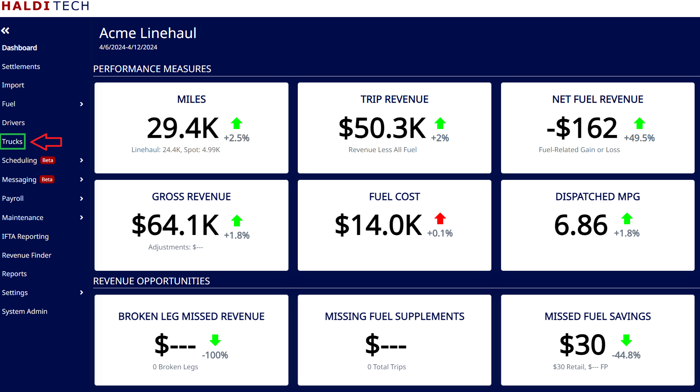

## Adding a location to a truck

Go to **Trucks** and open the truck you want to update — double-click it, or select it and click **Edit** — then click the **edit (pencil)** icon.

Select the **Locations** tab. Click **Add**, choose the **Effective** date, pick the **Region/Location**, and click **Save**.

> **Note:** You need to have your Regions and Locations defined first. See [Regions and Location](/support/regions-and-location).
