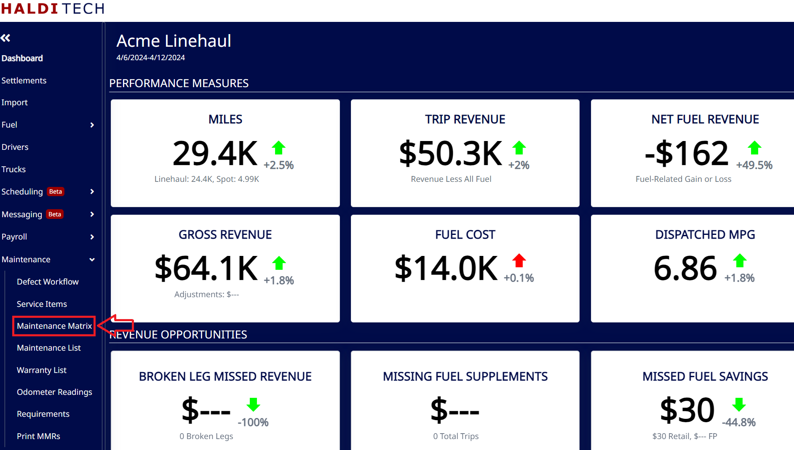
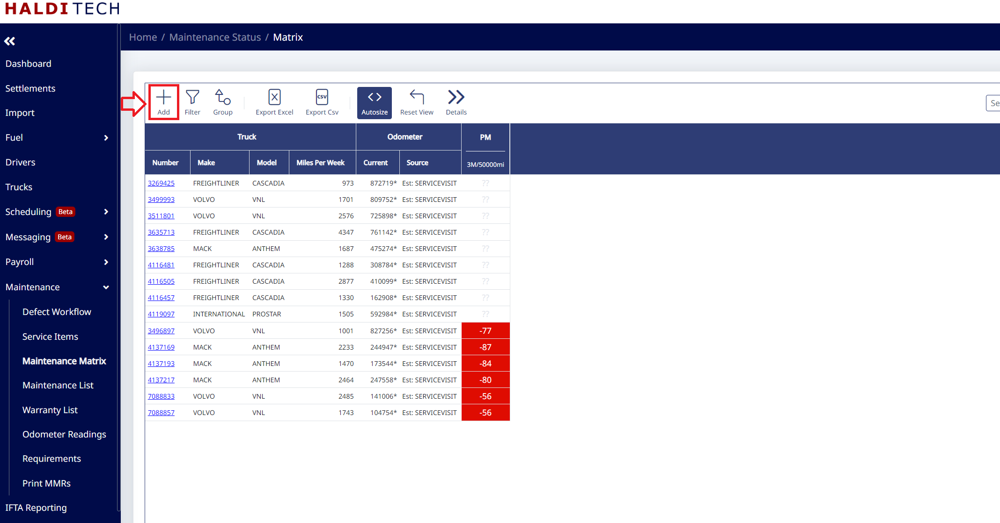

## Step 1. Open the Maintenance Matrix

Go to **Maintenance > Requirements** (the Maintenance Matrix).

## Step 2. Edit the interval

Double-click the requirement you want to change (or select it and click **Edit**). Update the **Every** interval — and **Based On**, if you're switching between miles and time.

## Step 3. Save

Click **Save**.
