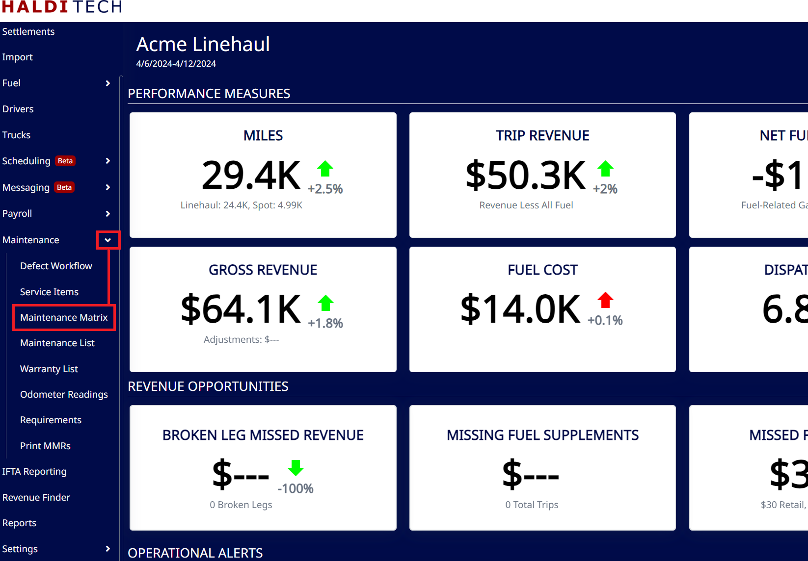
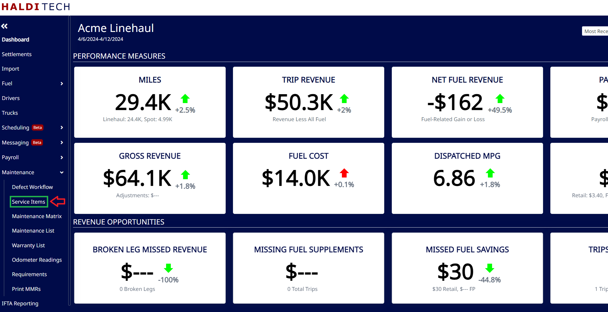

## Creating a Service Record

In your HaldiTech software, go to **Maintenance > Service Items**.

Click the **Add** button on the toolbar. On the form, fill out the service details — the **Truck**, the service dates, the **Service** and **Service Type**, odometer, shop, invoice, and costs — then click **Save**.

> **Note:** FedEx requires a description for the service — use the **Other Description** or **Notes (Included On MMR)** field.
