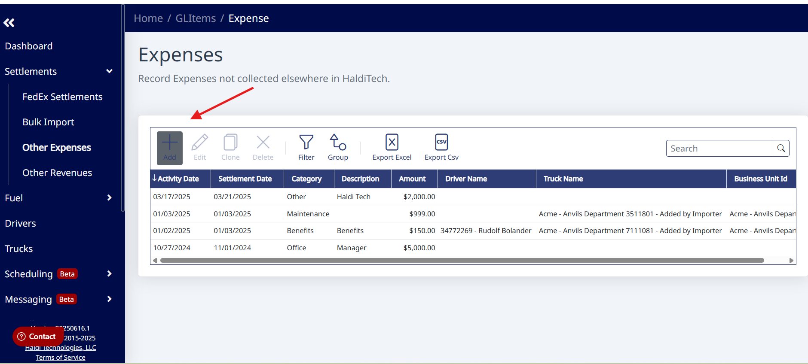
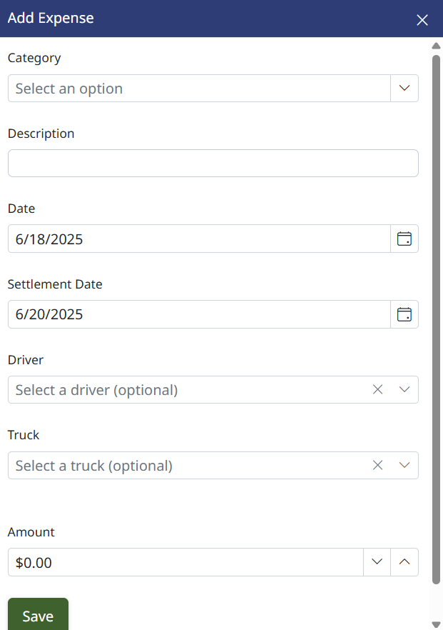

# Using Other Revenues & Expenses

Add revenues and expenses that are not included on your FedEx settlements.

## Step 1. Open Other Revenues or Other Expenses

Click **Settlements** and select either **Other Revenues** or **Other Expenses**.

## Step 2. Add a new record

Click the **Add** button on the toolbar to create a new revenue or expense.

## Step 3. Enter the details

Choose a **Category**, type a **Description**, and set the **Date**. Optionally associate the item with a **Truck** or **Driver**, and set **Repeats** if it should recur. Enter the **Amount**.

## Step 4. Save

Click **Save** — your revenue or expense is now included in reporting and the HaldiTech P&L.

---

**Need Help?** [support@halditech.com](mailto:support@halditech.com) or call us at 470-594-2534
