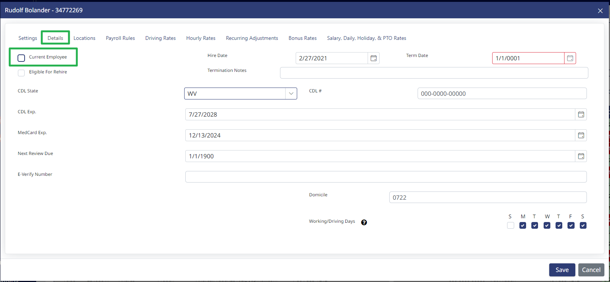
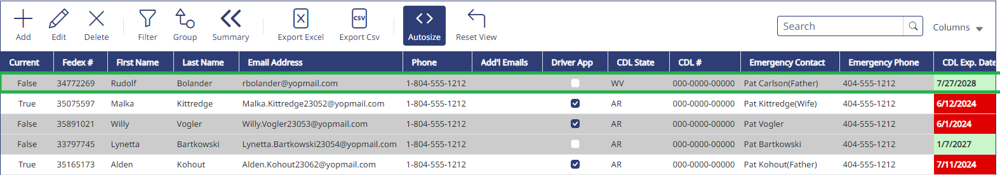

Instead of permanently deleting a driver, mark them as no longer working for you.

Go to **Drivers**, select the driver and click **Edit** on the toolbar (or double-click the driver) to open their record, then click the **edit (pencil)** icon. On the **Details** tab, uncheck **Current Employee**.

Once **Current Employee** is unchecked, you can optionally enter a **Term Date**, **Termination Notes**, and flag the driver as **Eligible For Rehire**. These fields are optional. Click **Save**.

Once a driver is marked not current, they appear **in grey** in the driver list and no longer show up in Payroll, Scheduling, or Messaging.

If you no longer want to see them in the list, filter the **Current** column to **True**.
