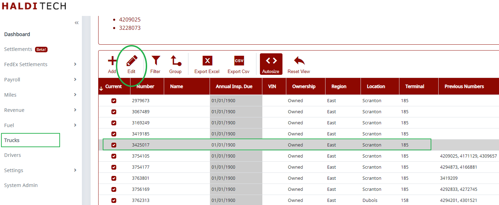
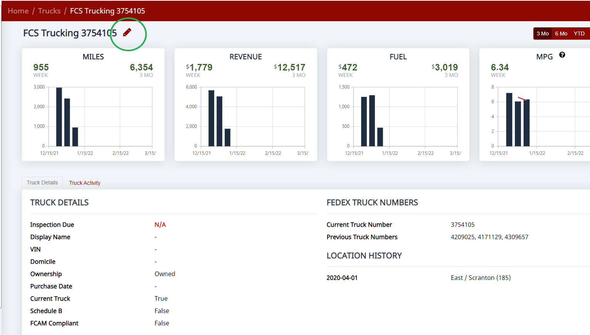

Instead of deleting a truck, it's best to mark it **inactive**. Deleted trucks are automatically re-added from your settlement data, so a truck you remove will just come back.

## Make a truck inactive

Go to **Trucks**. Double-click the truck you want to change — or select it and click **Edit** on the toolbar — to open its profile.

On the truck's profile, click the **edit (pencil)** icon next to the truck number at the top to open its settings. On the **Settings** tab, uncheck **Current Truck** and click **Save**.

The truck stays in your records and on past settlements, but is treated as inactive going forward.

## If the truck number changed

If it's the same truck but FedEx issued a **new truck number**, use **Merge** rather than adding a second truck: on the **Trucks** list, select the record with the **new** truck number, click **Merge** on the toolbar, and follow the prompts. (You can also view a truck's numbers on the **Truck Numbers** tab inside its settings.) Once merged, you don't need to do anything with the old number.

> **Note:** If you delete a truck from the list, it will be re-added automatically the next time you open a settlement that includes it — trucks are created from settlement data. That's why marking a truck inactive (unchecking **Current Truck**) is the right approach.
