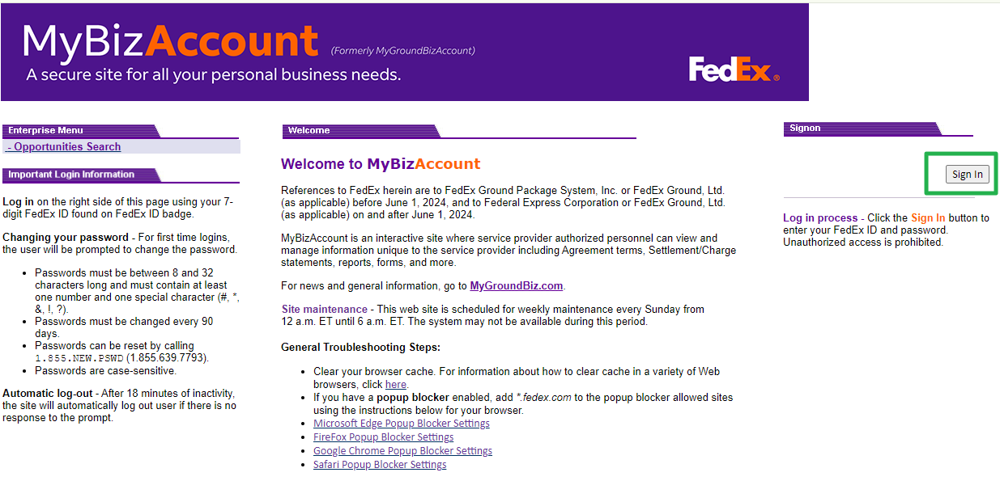
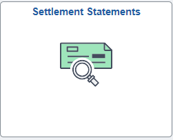
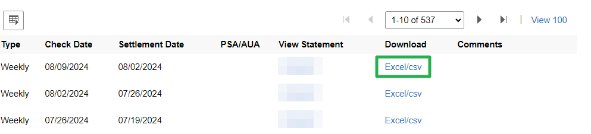
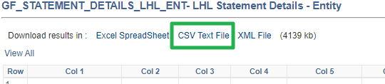
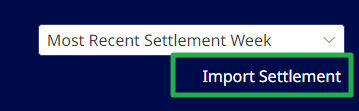

# How to Import Settlements

## Step 1. Sign in to MyGroundBiz.

First, go to your MyGroundBiz Portal and sign in.

## Step 2. Open Settlement Statements.

Click on Settlement Statements.

## Step 3. Download the settlement as a CSV.

Find the settlement you want to work on. Download it as a CSV file.

Then click "CSV Text File" to download.

## Step 4. Start the import in HaldiTech.

Sign in to HaldiTech. In the left menu, click **Settlements**, then **FedEx Settlements**. On the settlements toolbar, click **Import New**.

> **Important:** If you manage more than one contract, confirm the correct company is selected in the account menu at the top right before you import.

## Step 5. Choose the CSV file.

Select the settlement CSV file you downloaded from MyGroundBiz. HaldiTech imports it and adds the settlement to your list.
