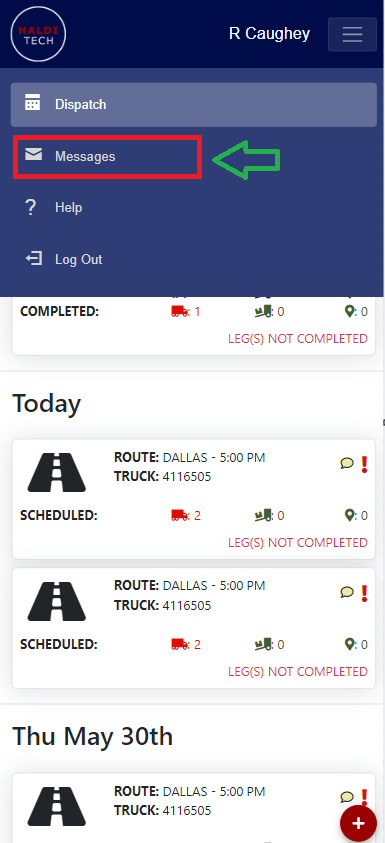

# How to message your dispatcher

In the mobile app, on the **Dispatch** screen, tap the red **+ (Actions)** button in the bottom-right corner and choose **Note To Dispatch**.

Enter a **Subject** and your **Message**, then send it. You can see your past messages from the **Message List** link at the top.

