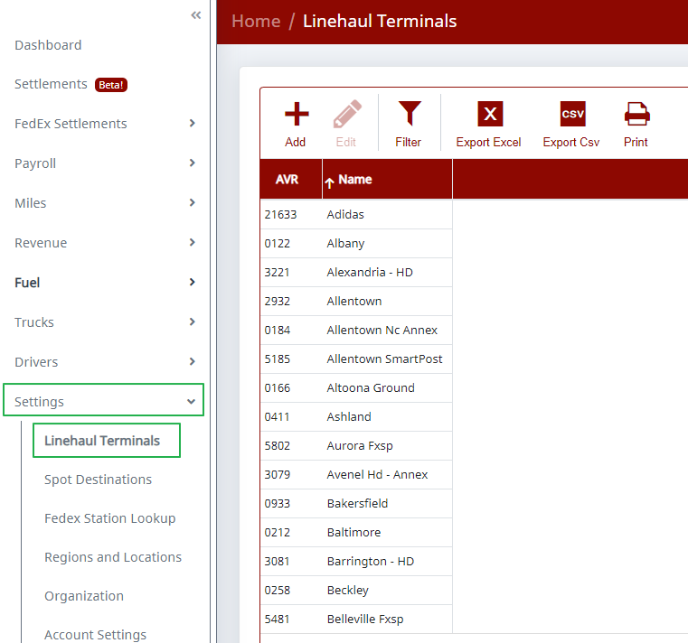

# How To Rename Butt Head Locations

To rename the Butt Heads / Bumps, go to **Settings > Linehaul Terminals** and find that **AVR** number in the list (the system auto-adds it the first time it's seen on a settlement). Use the **Search** box to narrow the list.

Double-click that row to edit it directly in the grid, enter the **Name** as you'd like it displayed, and save your change.

> **Note:** We haven't been able to get a list of Butt Head locations from FedEx, so we're not able to pre-populate them in the system.
