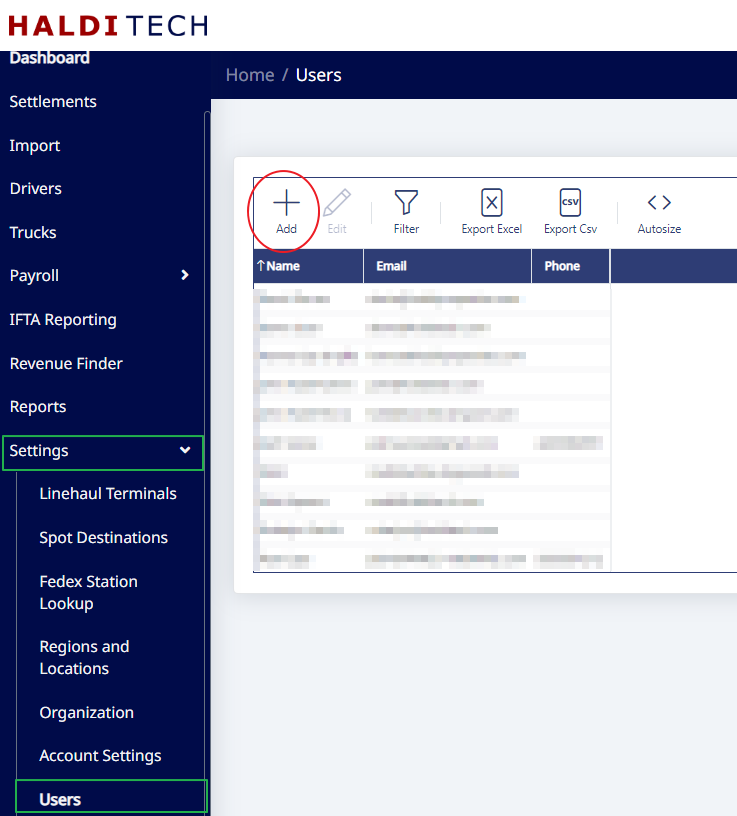
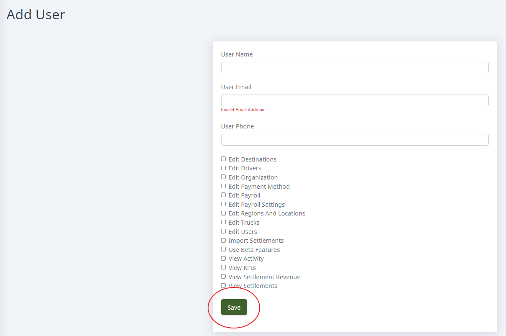

## Add the user

Sign in to your HaldiTech account. In the left menu, go to **Settings > Users**, then click **Add**.

Enter the user's name, email, and phone number. Select the permissions you want to grant them, then click **Save**.

## Have the user set their password

The new user will go to [fcs.halditech.com](https://fcs.halditech.com/), click **Set Your Password**, and follow the steps.

