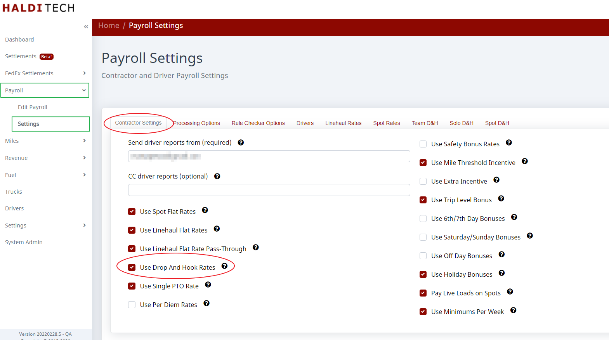
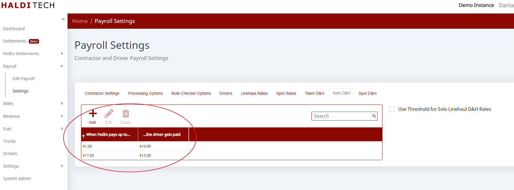

# How To Set Up D & H Rates for Drivers

Setting up Drop & Hook (D&H) pay takes three steps.

## Step 1. Turn D&H rates on

Go to **Payroll > Settings**. On the **Contractor** tab, check **Use Drop And Hook Rates**.

## Step 2. Add the rate rules

Rate rules live on the **Team D&H**, **Solo D&H**, and **Spot D&H** tabs. Set **Pay based on** (for example, FedEx Payment), then click **Add** to create a rule. Each rule reads "when FedEx pays at least X, the drivers get paid Y." Entering `$1` makes the rule trigger for any D&H payment FedEx makes; add more rows to pay more for higher FedEx payments (for example, "when FedEx pays at least $17, the driver gets $15").

## Step 3. Optionally use a threshold

Turn on the **Use Threshold...** option on the tab to pay D&H only on shorter trips, where D&H is a bigger percentage of the total compensation for the trip.
