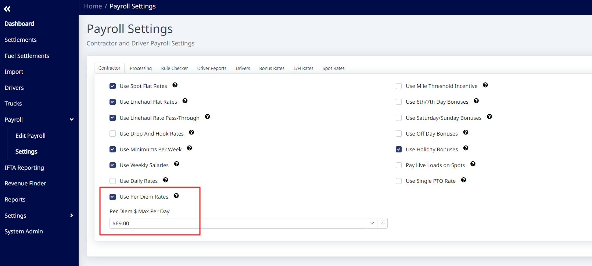

Here's how we look at per diems. If you haven't read it yet, start here: [Per Diems](/support/per-diems).

## Step 1. Turn on per diem rates

Go to **Payroll > Settings**. On the **Contractor** tab, check **Use Per Diem Rates** and enter the amount you pay per diem in the box that appears.

## Step 2. Enable solo OTR per diem on the driver

Open the driver's record (**Drivers** > select the driver > **Edit** > the pencil icon) and check **Driver Gets Per Diem for Team Trips**. A new option appears, **Include Solo OTR Trips in Per Diem Calculations** — turn that on too. This applies per diem to **all** solo trips for that driver.

## Step 3. Verify or override days worked each week

Each week, go to the **Days Worked** tab in Payroll. The **System Guess** column shows how many days of per diem a driver will get. If it's wrong (for example, a driver drove 5 days but only had 3 nights OTR), override the system guess with the correct number — highlight the driver, click **Edit**, and enter the days worked.
