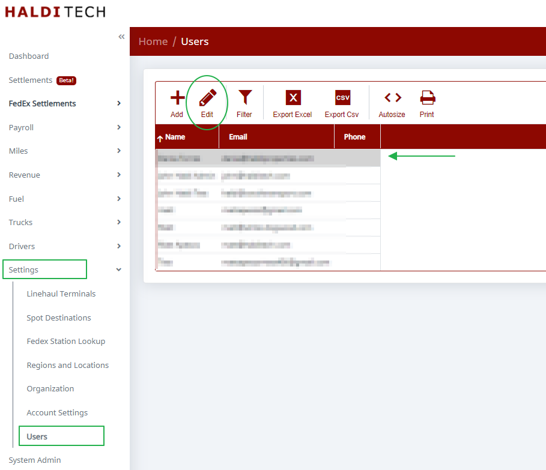
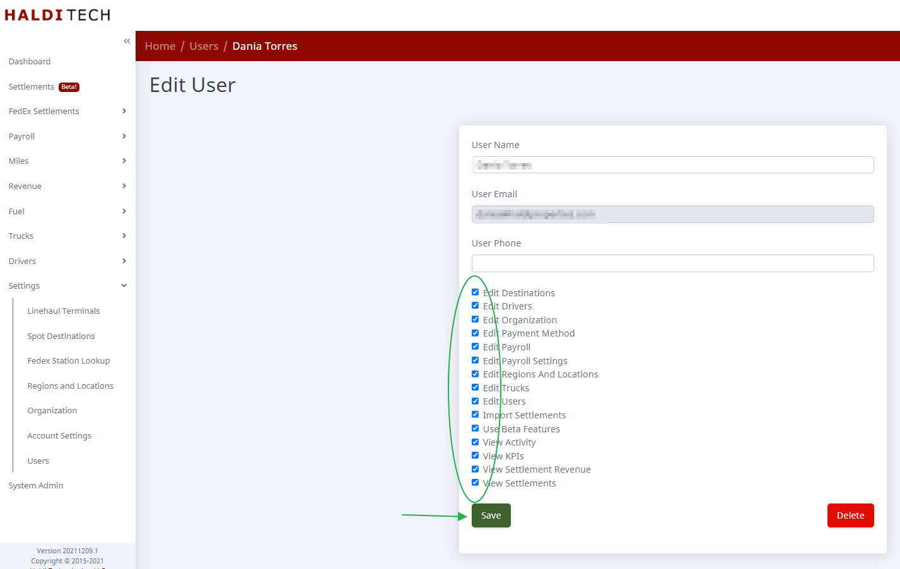

Go to **Users** in the left menu. Select the user whose permissions you want to change, then click **Edit** on the toolbar.

On the **Edit User** screen, check or uncheck the permissions for that user — use **Select All** / **Select None** to toggle everything at once — then click **Save**.

