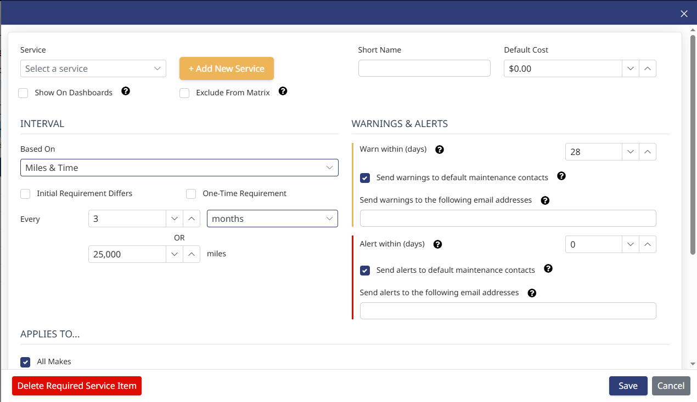
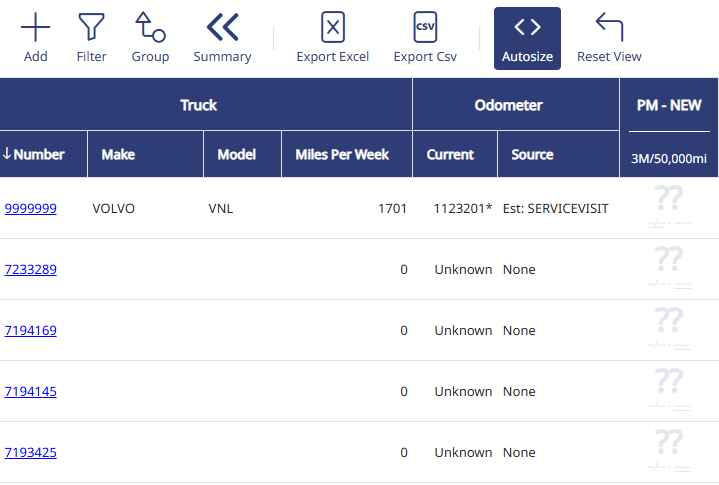

Set up the preventative-maintenance services you want to track and how often they're due.

## Step 1. Open Requirements

Go to **Maintenance > Requirements**. This is where you define each required service and its interval — it's what populates the Maintenance Matrix.

## Step 2. Add a service requirement

Click **Add**. Choose an existing **Service**, or click **+ Add New Service** to create one (for example PM, Oil Change, DoT Inspection, Overhead). Under **Based On**, choose whether it's measured by miles, time, or both, and enter the interval in the **Every** field.

To get emailed reminders as a service nears its due date, add addresses in the **Send warnings to...** and **Send alerts to...** boxes. Choose which trucks it **Applies To**, then click **Save**.

## Recording completed work

When a service is performed, record it under **Maintenance > Service Items** so the Matrix knows it was done and can track the next due date. (See *How to create a service ticket in Maintenance*.)
