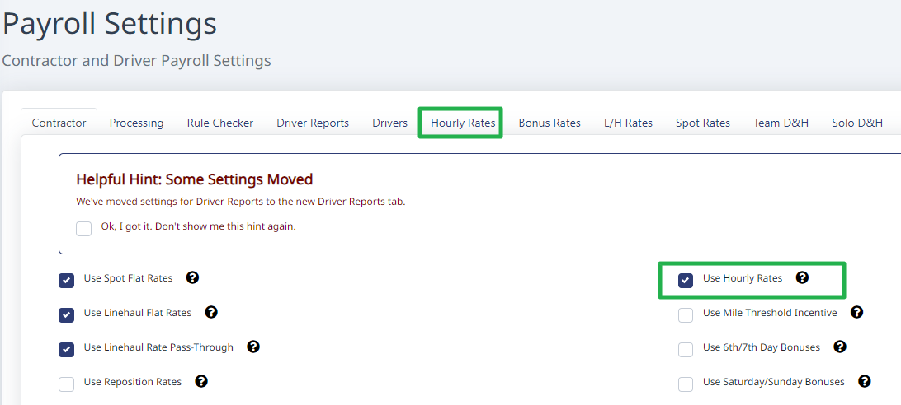
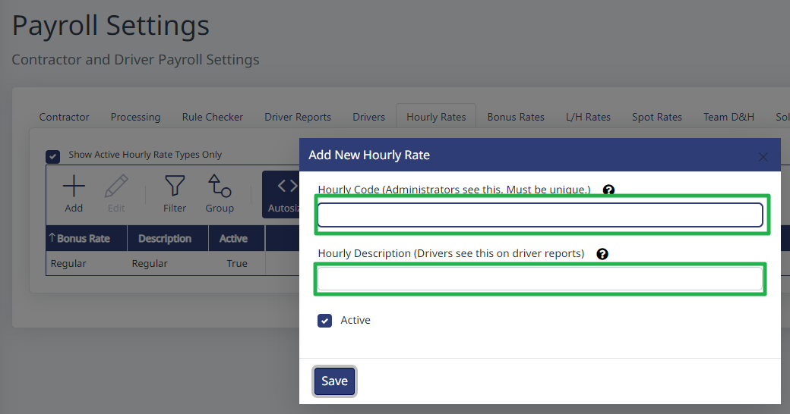

## Step 1. Turn on hourly rates

Go to **Payroll > Settings**. On the **Contractor** tab, check **Use Hourly Rates**. A new **Hourly Rates** tab appears at the top.

## Step 2. Create your rate types

On the **Hourly Rates** tab, click **Add** and give the rate a name — for example, one called **Regular** and one called **Overtime**.

## Step 3. Assign a rate to each driver

Open each driver's record (**Drivers** > select the driver > **Edit** > the pencil icon) and go to the **Hourly Rate** tab, then set that driver's rate.

## Step 4. Enter driver hours

In **Payroll**, open the **Driver Hours** tab and click **Add**. Select the driver, the number of hours, and which rate type to apply.
