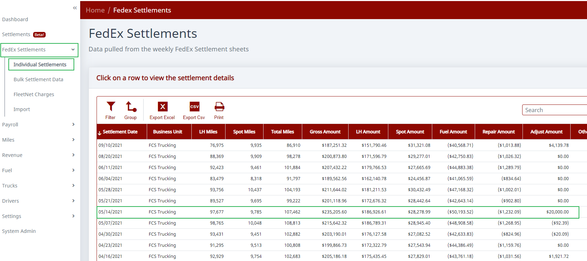
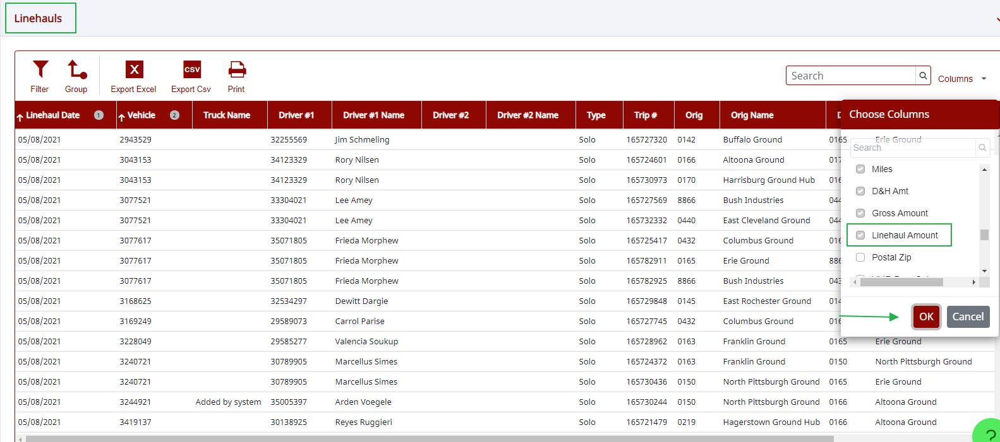

# How to View Net Revenue After Fuel

Net revenue after fuel is shown directly on each settlement's **Summary** tab — there's no column to set up.

## Step 1. Open FedEx Settlements.

In the left menu, click **Settlements**, then **FedEx Settlements**.

## Step 2. Open an individual settlement.

Double-click the settlement you want to review (or select it and click **Edit**). It opens on the **Summary** tab.

## Step 3. Read net revenue after fuel.

The **Summary** tab shows two side-by-side breakdowns:

- **FedEx Settlement P&L** — gross revenue (Linehaul + Spot), then fuel and repairs subtracted, down to a **Net Total**.
- **HaldiTech P&L** — total revenue with fuel taken out as Cost of Goods Sold, giving **Gross Profit** (your revenue after fuel), and continuing down to Operating and Net Income.

The **Net Fuel Revenue / Mi** tile at the top shows your net fuel revenue per mile at a glance.

