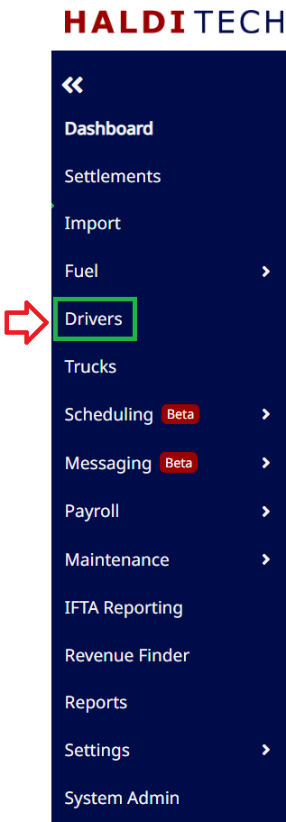

# Mobile App Integration For Driver

## Register your driver

In HaldiTech, go to **Drivers** in the left menu. Make sure the driver has an **email address** and **phone number** on their record, then **right-click** the driver and choose **Register For App**.

## Create your login and password

The driver receives an email with their username and a link to create a password. After opening the link, they click **Send Verification Code**, enter the code, and set their password. They can then sign in to the mobile app.
