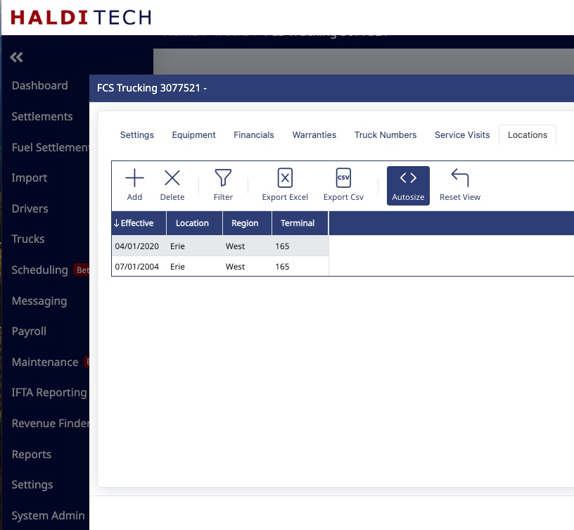
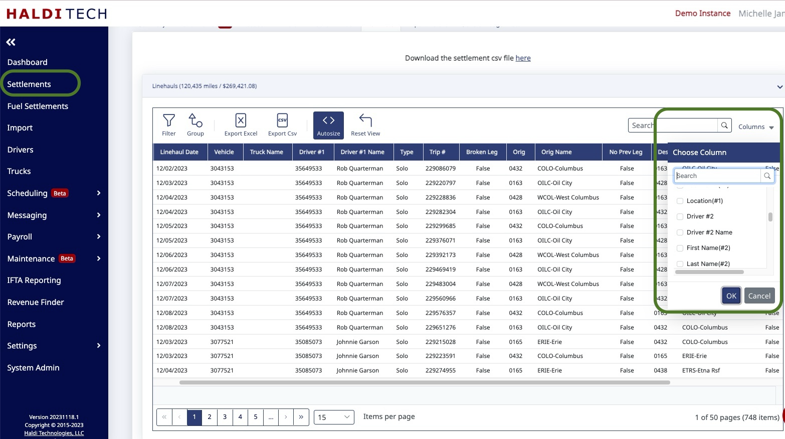

Regions and Locations is a feature designed to enrich your data with truck-level specifics for where a truck is located. This lets you "bucket" your data to match how you divide up your operations. It was requested by a number of contractors who wanted the ability to bucket their data according to where a truck lives within their operation.

We use the terms Regions and Locations because that's how most contractors use the feature, but you could also think of them as Category and Subcategory. There's really no limit on what you can put into the fields, and hence no limit on how you might want to organize your data.

## Creating / editing Regions and Locations

Go to **Settings > Regions and Locations**. Define your higher-level **Regions**, and under each one add the **Locations** that belong to it. Here's an example using our demo data:

## Adding a Region / Location to a truck

Once you've defined your Regions and Locations, edit each truck: go to **Trucks**, open the truck, click the **edit (pencil)** icon, and select the **Locations** tab. Use **Add** or **Delete** to set the Regions and Locations for the truck, with the date each one takes effect. In this example, you could say that a truck was in Erie on April 1st, then again on July 1st.

## Reporting on Regions / Locations

When pulling reports on your miles, revenue, etc., you can drill those reports down by Region and Location. That gives you a picture of how many miles you drove in each region. If you've got a large fleet with multiple managers, this provides helpful breakdowns of your data, separated by whatever Regions/Locations you've defined.

## Using Regions / Locations in settlement data

Anywhere the system provides truck-specific information, it shows the vehicle number, and the Region/Location for that truck is folded in by date — you just need to enable those columns. For example, open a settlement, look at **Linehauls**, and use the column dropdown in the upper-right of the grid to add the **Region** and **Location** fields:

The correct Region/Location is attached based on the dates you specify. You can then filter and group that data in the grid using those fields, and export to Excel with those fields turned on for further analysis.
