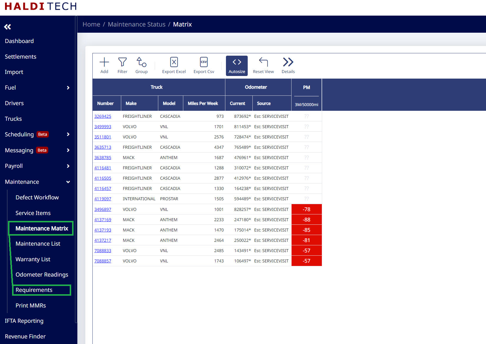
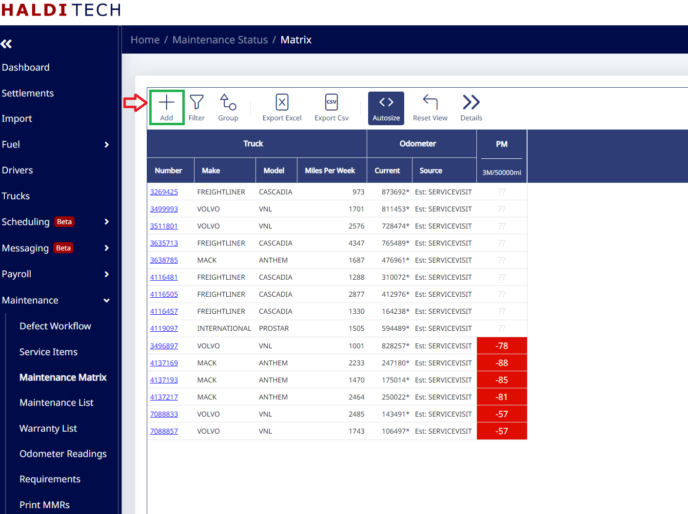

# Requirements

The **Requirements** tab (under **Maintenance**) is where you build the preventative-maintenance services that populate the **Maintenance Matrix**. You can create any requirement you need — DoT inspections, PMs, oil changes, overheads, tires, and so on.

## Adding a service to the Matrix

In **Requirements**, click **Add**. Choose an existing **Service** or click **+ Add New Service** and give it a **Short Name**. Set **Based On** (miles, time, or both), the **Every** interval, which trucks it **Applies To**, and optional warning/alert emails, then click **Save**.

## How the Matrix figures out what's due

The Matrix shows when each truck's next service is due. It's driven by odometer readings pulled from **TruckSpy** or **MileageReports** (shown in the **Source** column). If you don't have either, HaldiTech uses the average miles from your settlements, added to the odometer recorded on the truck's last service visit.
