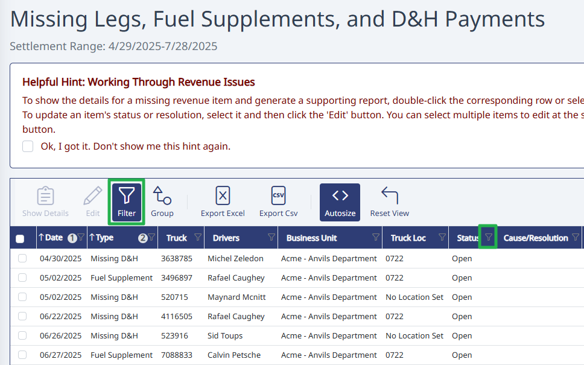
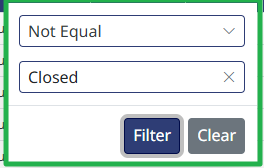

## Using the Revenue Finder Filter

Remove closed issues from your view so you only see open ones.

## Step 1. Turn on the column filters

In **Revenue Finder > Revenue Issues**, click the **Filter** button in the toolbar. A small filter icon appears next to each column header. (If you don't see the icons, click **Filter** once more.)

## Step 2. Filter out the Closed status

Click the filter icon next to the **Status** column. In the box that pops up, choose **Not Equal** from the dropdown, type **Closed** in the value box, and click **Filter**.

**Need Help?** [support@halditech.com](mailto:support@halditech.com) or call us at 470-594-2534
